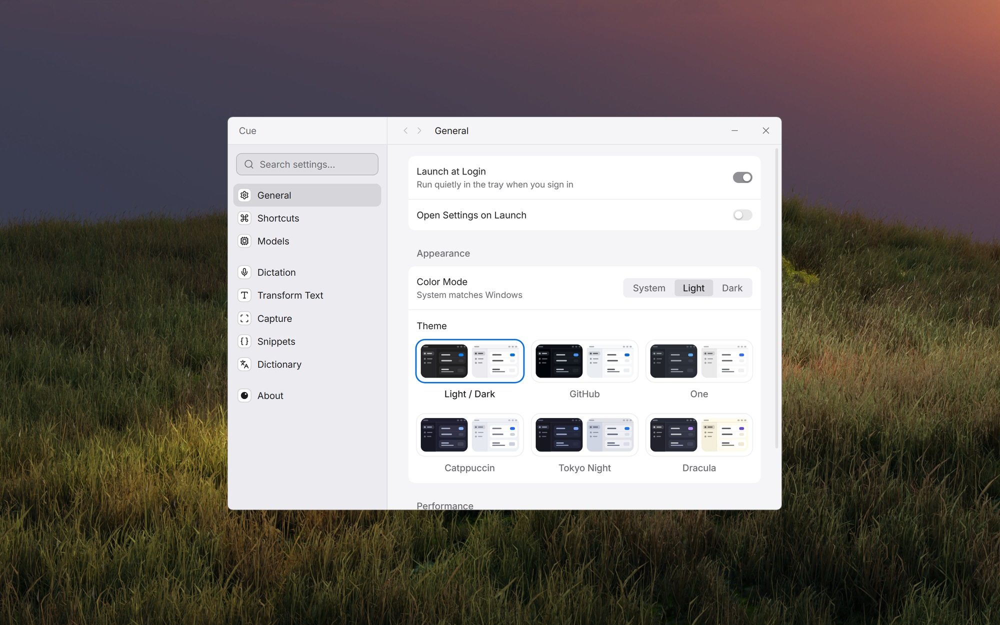

<div align="center">


# Cue

All your utilities in one lightweight Windows app.

[](https://github.com/Rishik15/cue/releases/latest)
[](LICENSE)



</div>

Cue replaces the separate tools you keep open for everyday text work: a dictation app, a text expander, an OCR tool, a dictionary and a notepad. It sits in the tray and answers one global shortcut per job, in whatever app you are using. Everything runs on your PC with no account and no cloud.

## Features

- **Dictation.** Hold `Ctrl + Space`, talk, release. The text is inserted at the cursor in any app. Speech recognition runs offline.
- **Transform Text.** Select text, press `Ctrl + Alt + Space`. Fix spacing and case, join broken lines, strip tracking from links, turn copied web content into Markdown, or run optional local text-model actions. Each option previews its result.
- **Grab Text.** Press `Ctrl + Alt + G` and drag over anything on screen to get its text, including images and apps that block copying.
- **Dictionary.** Select a word, press `Ctrl + Alt + D`. Meanings, examples and synonyms, offline, English only.
- **Snippets.** Type `:sig` anywhere to expand saved text, with the date, clipboard or a prompt. Imports Raycast, Espanso, TextExpander and AutoHotkey.
- **Notes.** Press `Ctrl + Alt + N` for an instant note with math, checklists and timers on any line:

```text
12 x 8 =                     96
rent: 900
rent / 4 =                   225
10 ft to m                   3.05 m
[ ] book the flights         Ctrl + Enter ticks it
timer pomodoro x4            25 min focus, 5 rest, four rounds
```

Every shortcut can be changed in Settings. Speech models, text models and the dictionary pack download from Settings when you press Download; several can download at once, each with its own cancel.

**Planned:** a file shelf, file optimization and conversion, screen tools, code signing and a winget package.

## Install

Download the installer from the [latest release](https://github.com/Rishik15/cue/releases/latest) and run it. Requires 64-bit Windows 10 or 11.

Cue is not code-signed yet, so SmartScreen warns on first run: choose **More info**, then **Run anyway**. Each release lists the installer's SHA-256.

## Privacy

Text, audio and screen captures stay on your PC, and Cue sends no telemetry. The network serves model downloads you start and one update check at startup (switch it off in About); updates install when you press Update. Your data lives in `%APPDATA%\dev.cue.app`; **Remove All Cue Data** in About deletes it. [SECURITY.md](SECURITY.md) has the details and limits.

## More

[Contributing](CONTRIBUTING.md) · [Changelog](CHANGELOG.md) · [Report a bug](https://github.com/Rishik15/cue/issues) · [Third-party notices](THIRD_PARTY_NOTICES.md) · [MIT License](LICENSE)
