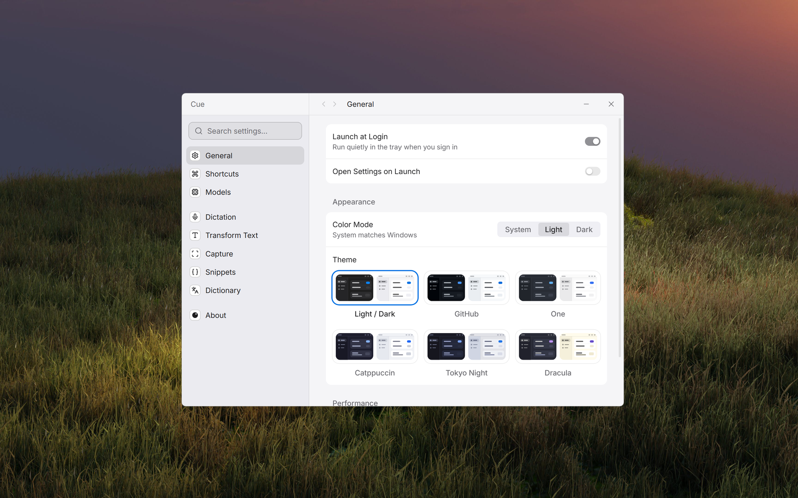

<div align="center">


# Cue

All your utilities in one lightweight Windows app.

[](https://github.com/Rishik15/cue/releases/latest)
[](https://github.com/Rishik15/cue/releases/latest)
[](LICENSE)

[What it does](#what-it-does) · [Install](#install) · [Privacy](#privacy) · [Roadmap](#roadmap) · [Build](#build-from-source) · [Changelog](CHANGELOG.md)



</div>

Cue is a tray app for the everyday jobs that normally send you to another app or another tab: dictating, quick math, cleaning up pasted text, looking up a word, reading text off the screen, expanding snippets, taking notes. Each one is a shortcut away.

- It all runs on your PC. No account, no cloud, nothing uploaded.
- Waiting in the tray it uses about 4.4 MB of memory and no CPU.
- It's free and MIT licensed.

## What it does

### Dictation

Hold `Ctrl + Space`, talk, and let go. What you said is typed at the cursor, in any app. The speech model runs offline.

### Selection palette

Select text anywhere and press `Ctrl + Alt + Space`. You can fix spacing, change case, join lines a PDF broke, strip tracking from links, or turn copied web formatting into Markdown. Each option shows its result before you paste it.

### Grab Text

Press `Ctrl + Alt + G` and drag a box over anything on screen. If the text is in an image, or in an app that won't let you copy, you get it back as text you can paste.

### Dictionary

Select a word and press `Ctrl + Alt + D`. A card shows its meanings, examples and synonyms. It works offline.

### Snippets

Type `:sig` in any app and it becomes your saved text. Snippets can include the date, the clipboard, or a question Cue asks you first. You can import yours from Raycast, Espanso, TextExpander or AutoHotkey.

### Notes

Press `Ctrl + Alt + N` for a note that opens instantly and saves as you type. Math, lists and timers work on any line:

```text
12 x 8 =                     96
rent: 900
rent / 4 =                   225
10 ft to m                   3.05 m
[ ] book the flights         Ctrl + Enter ticks it
timer pomodoro x4            25 min focus, 5 rest, four rounds
```

Press `Ctrl + Shift + V` and everything you copy in other programs is added to the note, until you press it again.

Every shortcut can be changed in Settings.

## Install

1. Download the installer from the [latest release](https://github.com/Rishik15/cue/releases/latest).
2. Run it.
3. Go through the first-run walkthrough, then try a shortcut.

Cue runs on 64-bit Windows 10 and 11. Models are only downloaded when you press a Download button.

<details>
<summary>Windows says it protected my PC</summary>

Cue isn't code-signed yet, so SmartScreen warns about it. Choose **More info**, then **Run anyway**. Each release lists the installer's SHA-256 if you want to check the download first.

</details>

<details>
<summary>Updates and your data</summary>

Cue checks for a newer version at startup and only installs it when you press Update. You can turn the check off in About. Settings, snippets and notes live in `%APPDATA%\dev.cue.app`, and Remove All Cue Data in About deletes them.

</details>

## Limits

- The dictionary is English only. Speech models and the text model are optional downloads.
- Cue is still in early 0.x releases, so expect rough edges. Tell me about them on the [issues page](https://github.com/Rishik15/cue/issues).

## Privacy

Everything runs on your PC. The only network use is downloads you start yourself and one update check at startup. Nothing you type, say or capture is uploaded. More detail is in [SECURITY.md](SECURITY.md).

## Roadmap

Rough order, no dates.

- [x] Dictation
- [x] Selection palette
- [x] Grab Text
- [x] Dictionary
- [x] Snippets
- [x] Notes
- [ ] A shelf for collecting files while you work and dragging them out later
- [ ] An optimizer to shrink and convert images, PDFs and videos
- [ ] Screen tools: circle to search, zoom and draw
- [ ] Code signing and a winget package

Is something annoying you that Cue could fix? Open an [idea](https://github.com/Rishik15/cue/issues/new/choose).

## Build from source

You need Rust (MSVC), Node.js 24 or newer, pnpm and the Visual Studio C++ Build Tools.

```powershell
git clone https://github.com/Rishik15/cue.git
cd cue
./scripts/cue.ps1 setup
./scripts/cue.ps1 dev
./scripts/cue.ps1 build
```

`setup` checks your tools, `dev` runs with hot reload, and `build` makes the exe and the installer. Cue is a [Tauri 2](https://tauri.app) app with a Rust backend and a SolidJS front end.

[Changelog](CHANGELOG.md) · [Security](SECURITY.md) · [Third-party notices](THIRD_PARTY_NOTICES.md) · [MIT License](LICENSE)

Notes was inspired by Antinote.
